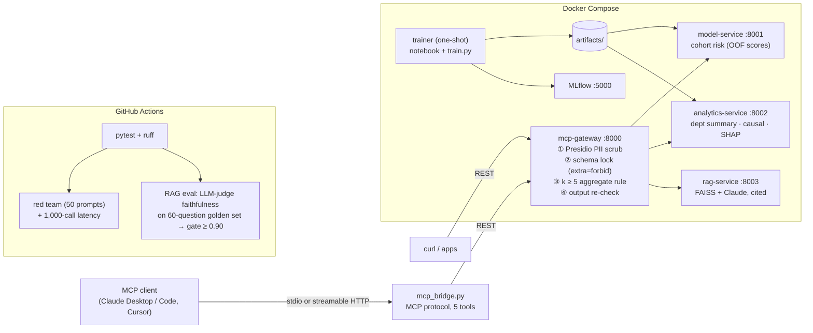

# TalentPulse – People Analytics Copilot (POC)

Aggregate-only people analytics on the IBM HR Attrition dataset (1,470 employees), served to any MCP client through
a guarded gateway, with a policy-RAG assistant that is quality-gated in CI.

## Architecture



**Privacy model.** Every layer enforces k ≥ 5 independently (model service, analytics service, gateway). Only enumerated
cohort attributes can be filtered (no IDs, names or free-form values); unknown fields are rejected; validation errors
never echo input; every inbound string is scrubbed by Presidio before parsing, and RAG answers are scrubbed again
outbound. Per-employee scores and SHAP values never leave the services. Cohort risk is computed from **out-of-fold**
predictions, so served numbers are not inflated by in-sample fit.

## Repository layout

```
notebooks/01_causal_and_stats.ipynb   chi-square, Mann-Whitney, logit ORs, LR driver ranking, PSM + bootstrap, IPW
scripts/build_notebook.py             notebook source of truth (reviewable diffs)
src/common/                           data loading, cohort schema, privacy constants
src/model_service/train.py            calibrated LR vs XGBoost, stratified 5-fold CV, MLflow, SHAP, Fairlearn
src/model_service/api.py              FastAPI: cohort risk
src/analytics_service/app.py          FastAPI: department summary, overtime impact, drivers
src/mcp_server/server.py              FastAPI MCP gateway (5 tools, guardrails)
src/mcp_server/pii.py                 Presidio analyzer/anonymizer + employee-ID recognizer
src/mcp_server/mcp_bridge.py          official MCP protocol server (mcp>=2) wrapping the gateway
src/rag_service/{pipeline,app}.py     chunking, FAISS retriever, grounded generation; FastAPI
configs/rag_{baseline,tuned}.yaml     the two RAG configurations compared in eval
eval/                                 golden set (60 Q), LLM judge, RAGAS, Cohen's kappa, sweep, CI gate
redteam/                              50 adversarial tool calls + leak detector
loadtest/bench.py                     1,000-call latency benchmark
.github/workflows/eval-ci.yml         PR gates: tests → red team + latency, RAG faithfulness
```

## Results (measured)

Run on 2026-10-08 in a Linux sandbox (Python 3.12). Re-run and update this table yourself; every number below is
produced by code in this repo.

| Area | Metric | Value |
|---|---|---|
| Stats | Attrition, overtime vs. no overtime | **30.5% vs. 10.4%** (χ² p = 8e-21, Cramér's V = 0.25) |
| Stats | Odds ratio, crude / adjusted | 3.77 / **6.09** [4.29, 8.66] |
| Stats | Top driver (drop-one likelihood-ratio χ²) | **OverTime 116.8** vs. runner-up EnvironmentSatisfaction 28.6 |
| Causal | PSM ATT (1:1, no replacement, caliper 0.2 SD) | **+20.0 pts**, 95% bootstrap CI [+15.9, +25.9]; max \|SMD\| after = 0.099 |
| Causal | IPW ATT (robustness) | +20.6 pts |
| Model | Positive class | 16.1% |
| Model | Calibrated LR, 5-fold CV | ROC-AUC **0.830 ± 0.024**, Brier **0.095** |
| Model | Calibrated XGBoost, 5-fold CV | ROC-AUC **0.830 ± 0.020**, Brier **0.094** (selected) |
| Model | Top SHAP drivers | OverTime, StockOptionLevel, MonthlyIncome, JobRole, BusinessTravel |
| Fairness | Gender: DP diff / EO diff | 0.016 / 0.091 (within 0.10 tolerance) |
| Fairness | Age band: DP diff / EO diff | 0.256 / **0.528 — flagged** (see note) |
| Serving | Red team | **0 leaks / 50** (18 refused 400, 8 rejected 422, 24 safe 200) |
| Serving | Latency, 1,000 calls, concurrency 8 | p50 73 ms · **p95 108.5 ms** · p99 148 ms · 0 errors |
| RAG | Retrieval: gold source in top-k (offline TF-IDF embedder) | 98.2% (both configs) |
| RAG | Faithfulness baseline → tuned, κ vs. humans | **not yet measured** — requires `ANTHROPIC_API_KEY` and human labels (below) |

Notes:
- **Age-band disparity is a real finding, not a bug.** Age is a model feature and attrition differs sharply by age,
  so equalized-odds gaps are large. Options: drop Age, use group-specific thresholds (Fairlearn `ThresholdOptimizer`),
  or keep it and document why. The policy corpus says a gap > 0.10 triggers review — the audit is doing its job.
- Overtime in this dataset is nearly independent of observed covariates (propensities 0.15–0.50), which is why
  adjustment barely moves the effect (raw +20.1 → matched +20.0).
- Latency is for the four data tools plus `search_hr_policy` in `retrieve` mode; LLM-generated answers are excluded
  because their latency is set by the model provider. The red-team run used extractive (non-LLM) RAG answers; rerun
  it with `ANTHROPIC_API_KEY` set before claiming results for LLM-generated answers.

## Quick start

```bash
cp .env.example .env            # add ANTHROPIC_API_KEY for RAG generation and eval
docker compose up --build -d    # trainer runs the notebook + training, then 4 services start
docker compose logs -f trainer  # ~3 min on first run
open http://localhost:5000      # MLflow: benchmark run with nested LR / XGBoost runs
```

Local (no Docker):

```bash
python -m venv .venv && source .venv/bin/activate
make install            # deps + spaCy en_core_web_lg
make data notebook train
make test
make serve              # 4 services on :8000-8003
make redteam bench      # in a second terminal
make eval-baseline eval # needs ANTHROPIC_API_KEY
```

Databricks: clone the repo as a Git folder, run `%pip install -r requirements/train.txt`, then open the notebook.
Set `MLFLOW_TRACKING_URI=databricks` to log `train.py` runs to the workspace.

## API examples

```bash
# Tool manifest (name, description, JSON Schema)
curl -s localhost:8000/tools | jq '.tools[].name'

# Cohort attrition risk
curl -s -X POST localhost:8000/tools/get_attrition_risk -H 'content-type: application/json' \
  -d '{"filters": {"department": "Sales", "overtime": "Yes"}}' | jq

# Guardrail: requested group_size < 5  -> HTTP 400
curl -s -w '\n%{http_code}\n' -X POST localhost:8000/tools/get_attrition_risk -H 'content-type: application/json' \
  -d '{"filters": {"department": "Sales"}, "group_size": 3}'
# {"detail":"Privacy Guardrail Triggered: Minimum aggregate group size is 5"}

# Guardrail: cohort that resolves to < 5 employees -> HTTP 400
curl -s -X POST localhost:8000/tools/get_attrition_risk -H 'content-type: application/json' \
  -d '{"filters": {"job_role": "Research Director", "age_band": "18-30"}}'

# Department summary (job-role cells < 5 are suppressed)
curl -s -X POST localhost:8000/tools/get_department_summary -H 'content-type: application/json' \
  -d '{"department": "Research & Development"}' | jq

# Causal overtime results and global drivers
curl -s -X POST localhost:8000/tools/get_overtime_impact -H 'content-type: application/json' -d '{}' | jq
curl -s -X POST localhost:8000/tools/get_attrition_drivers -H 'content-type: application/json' -d '{"top_k": 5}' | jq

# Policy RAG with PII scrubbing (name and email are redacted before retrieval/generation)
curl -s -X POST localhost:8000/tools/search_hr_policy -H 'content-type: application/json' \
  -d '{"question": "Can Priya Sharma (priya.sharma@acme.com) carry forward unused leave?"}' | jq
```

## Connecting an MCP client

```jsonc
// Claude Desktop: claude_desktop_config.json
{
  "mcpServers": {
    "talentpulse": {
      "command": "python",
      "args": ["-m", "mcp_server.mcp_bridge"],
      "env": { "PYTHONPATH": "/path/to/talentpulse/src", "GATEWAY_URL": "http://localhost:8000" }
    }
  }
}
```

Or run `python -m mcp_server.mcp_bridge --transport streamable-http --port 8010` and point any client at
`http://localhost:8010/mcp`. The bridge only forwards to the gateway, so MCP clients get the same guardrails.

## RAG evaluation workflow

```bash
make eval-baseline                       # configs/rag_baseline.yaml (fixed 1,200-char chunks, k=2)
make eval                                # configs/rag_tuned.yaml (section-aware 600/100, k=4, score floor) — gated
python eval/sweep.py --judge-top 3       # grid over chunker/size/overlap/k/min_score
python eval/run_eval.py --metric both    # adds RAGAS faithfulness alongside the judge
```

**Validating the judge (Cohen's κ).** The kappa needs real human labels — none are shipped:

```bash
python eval/kappa.py export --rows eval/reports/tuned_rows.jsonl --out eval/human_labels.csv
# label `human_faithful` 0/1 for all 60 rows, blind to `judge_faithful`
python eval/kappa.py score --labels eval/human_labels.csv
```

The golden set has 57 answerable questions (each tied to a source document) and 3 out-of-scope questions that the
assistant should decline. CI runs the baseline for reference and fails the PR if the tuned config's faithfulness is
below 0.90. Add `ANTHROPIC_API_KEY` as a repository secret; set `JUDGE_MODEL` / `RAG_MODEL` as repository variables
to change models.

## Limitations

- k-anonymity on single queries does not stop **differencing attacks** (query n and n−1 cohorts). Production would
  add query auditing, rate limits, or differential-privacy noise.
- The dataset is synthetic (IBM), and the policy corpus is fictional; neither contains real PII. PII scrubbing is
  exercised on user inputs.
- `en_core_web_lg` NER is good but not perfect; an email-derived name backstop and an employee-ID pattern recognizer
  cover common misses. Always review the red-team report after adding new tools or fields.
